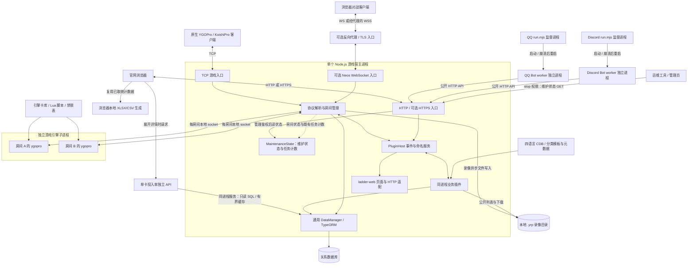
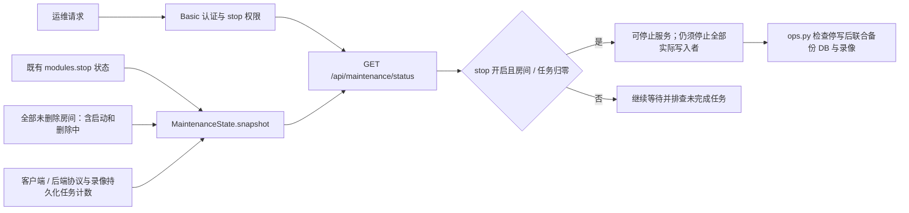
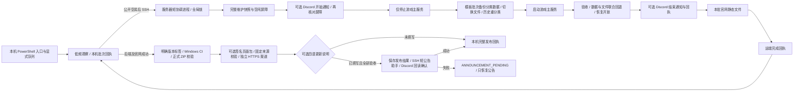
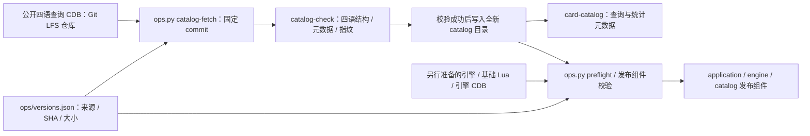
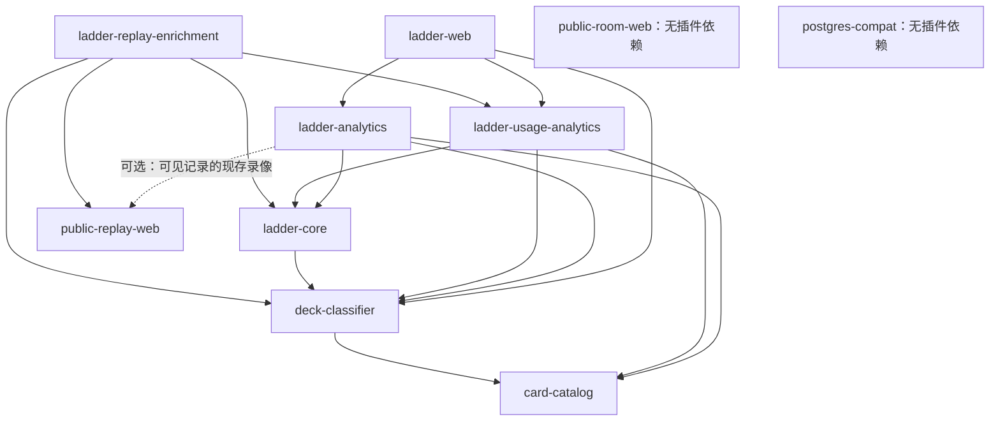
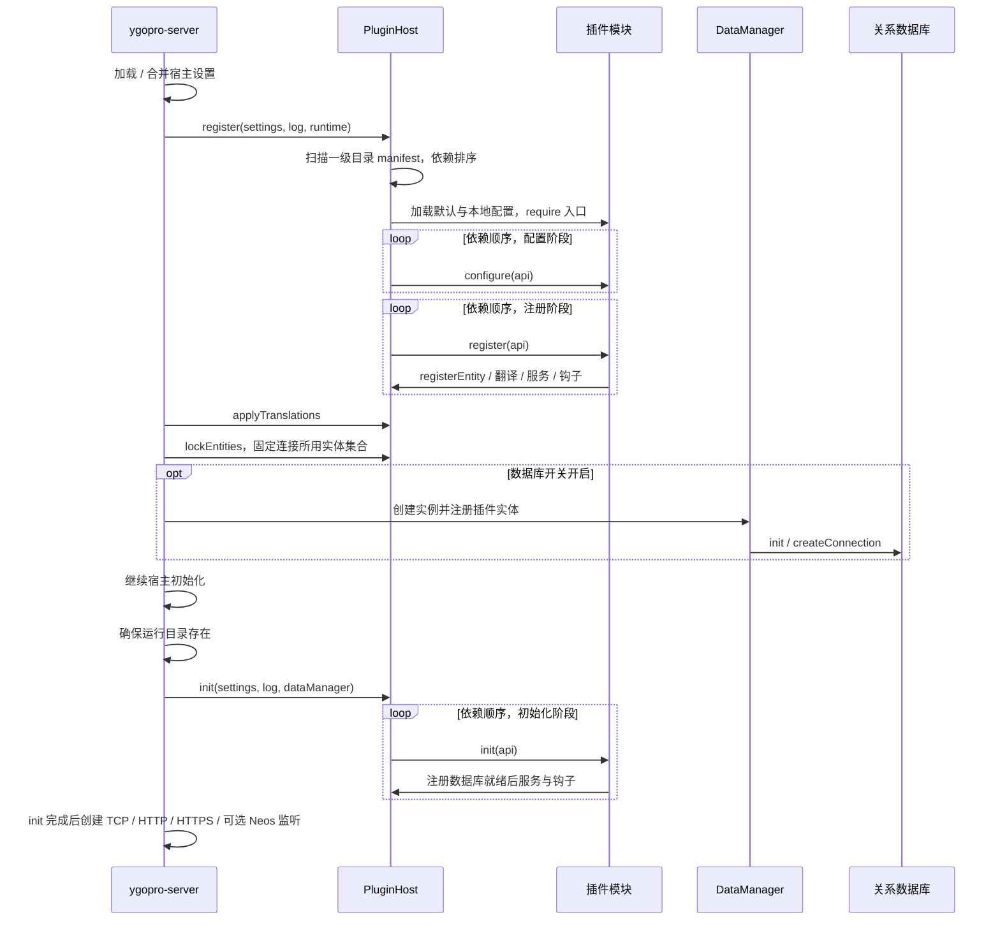
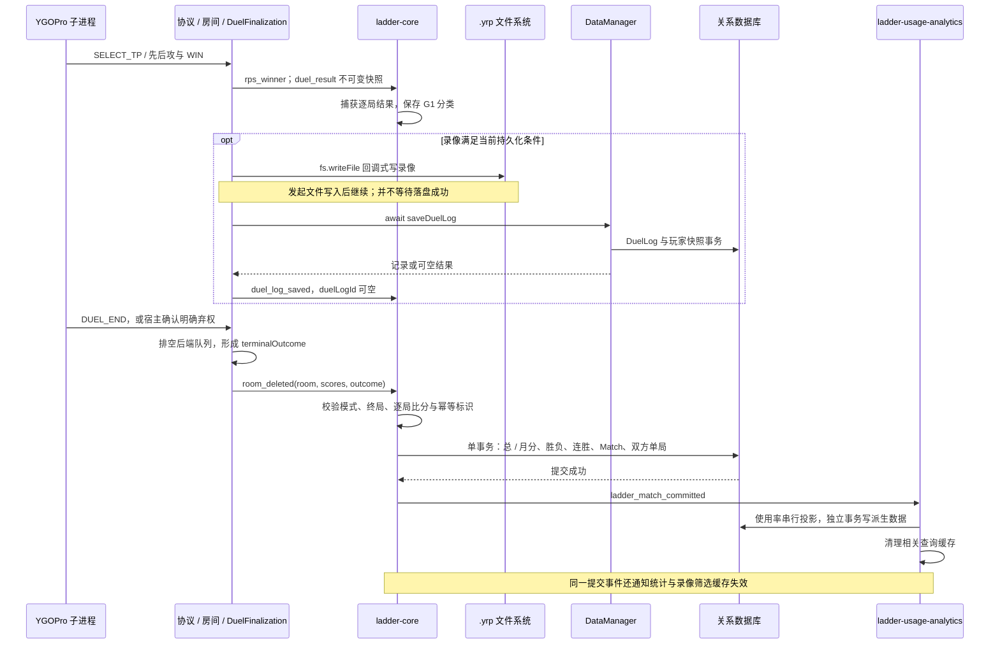
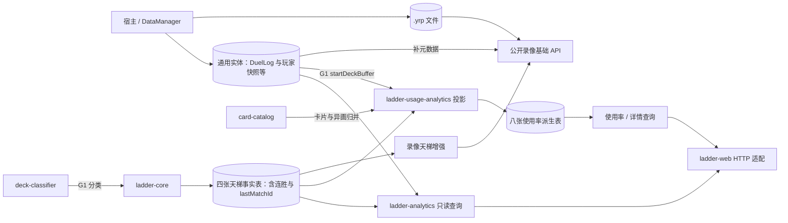
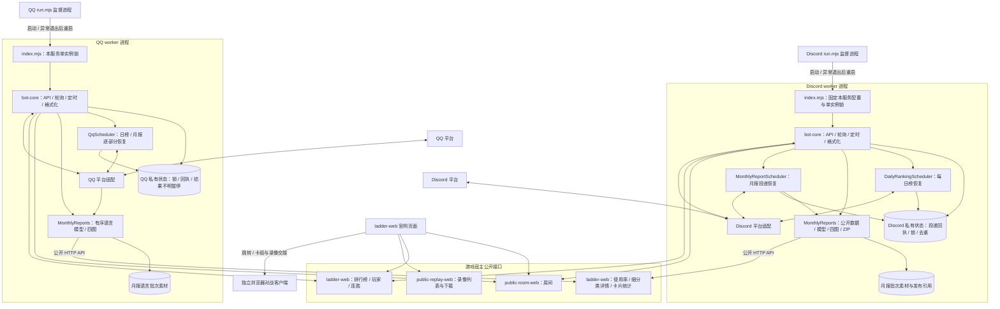
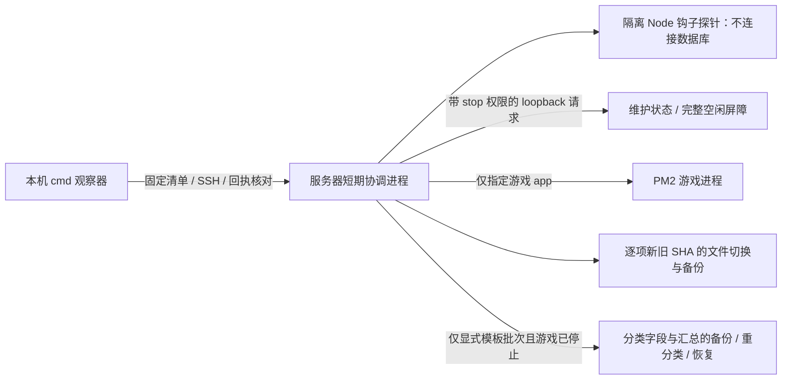

# 当前架构与数据流

维护基准：2026-10-28 收拢后的 `main` 源码。图文描述本仓库已收录的实现；
生产版本、实例启用状态和真实平台验收分别以发布清单、回执及对应服务记录为准。
运行拓扑核对未读取部署私有配置，图中的端口、代理和功能启用状态以实际配置为准。
固定引擎与双系统安装扩展仍在部署草稿 PR #7/#8，未由本次分支整理整体合入。

本文解释当前实现；职责约束仍以 [架构规范](REFACTORING_SPEC.md) 为准，字段与事务语义见
[数据契约](DATA_MODEL_AND_MIGRATION.md)，接口及统计定义见 [API 契约](WEB_AND_ANALYTICS_SPEC.md)。
它不是全新服务器安装或灾难恢复操作手册。

## 运行拓扑与进程边界

服务端采用“单个 Node.js 宿主 + 同进程业务插件 + 每房间 YGOPro 子进程”。
QQ 与 Discord 的业务 worker 独立运行，共用源码库，但不加载到游戏宿主。
服务器网页是 `ladder-web` 提供的原生 HTML/CSS/JavaScript；浏览器对战客户端是另外的项目。统计导出由浏览器本地生成 XLSX/CSV；固定 ExcelJS 静态库按需下载，不在服务端生成工作簿或增加数据库导出接口。

图中反向代理只是可选部署边界，不断言仓库已提供或已启用某个代理。官网 HTTP 入口也可放在代理后。
Neos 连接在 `neosRequestListener` 内适配后进入同一 `netRequestHandler`；它不是另一套计分服务。
宿主用 `rawSpawn` 从 `ygopro/` 启动 `./ygopro`，每个房间管理自己的进程、后端连接与终局状态。

| 责任 | 主要源码 | 进程内 / 外 |
| --- | --- | --- |
| TCP、HTTP、Neos、房间和重连 | [ygopro-server.coffee](../ygopro-server.coffee) | 宿主进程 |
| 协议常量、消息处理辅助 | [ygopro.coffee](../ygopro.coffee)、[YGOProMessages.ts](../YGOProMessages.ts) | 宿主进程 |
| 单局 WIN 坐标、录像和终局证据 | [duel-finalization.coffee](../duel-finalization.coffee) | 宿主进程 |
| 房间有效席位与等待房清理辅助 | [room-lifecycle.js](../room-lifecycle.js) | 宿主进程 |
| 维护状态与待完成任务计数 | [maintenance-state.js](../maintenance-state.js) | 宿主进程，观察既有队列和保存任务 |
| 插件发现、依赖与事件 / 服务 | [plugin-system.js](../plugin-system.js) | 宿主进程 |
| 连接、通用实体与插件事务 | [DataManager.ts](../data-manager/DataManager.ts) | 宿主进程连接外部数据库 |
| 实际对局规则执行 | `ygopro/ygopro` 与其数据文件 | 每房间子进程，外部游戏引擎资源 |
| QQ / Discord 平台接入 | [services 入口](../services/README.md) | 各自独立 Node.js 进程 |

CoffeeScript / TypeScript 是对应生成 JS 的修改入口；业务插件是原生 CommonJS JavaScript，
机器人沿用 ESM。根 `npm run build` 生成宿主 JS，不负责构建外部引擎或机器人部署包。

## 运维状态与资源准备边界

维护状态属于宿主，早于插件 HTTP 路由处理，使用既有管理员 `stop` 权限认证。
它观察原有任务，不新增结算队列或改变消息消费顺序。

`pendingWork` 包括 `client_protocol`、`server_protocol` 和录像文件、DuelLog、云录像任务；
`pendingPersistence` 只过滤协议项。`readyToStop` 是一次状态快照，不自动停进程、不自动备份，
也不涵盖任意第三方插件或外部 writer。操作和停写验证见 [联合备份](../ops/docs/backup-restore.md)。

Windows 代码升级另有 [本机发布监控](../ops/docs/windows-release-monitor.md)，只处理明确加入队列的候选。
模板批次可显式声明历史重分类与 Discord 维护通知；不执行普通 schema 迁移或封禁历史清理。
用户点击后本机常驻观察，服务器仅短时协调，不新增游戏进程内的后台任务。

助手首次迁移发布先核验 exe，再发布显式声明的签名页面包；页面包不占用 exe 的 latest，失败保留服务器已完成状态，仅恢复助手阶段。页面发布制品与公钥固定散列，来源固定到真实 Git 提交。

版本 2 清单可选 `releaseNotes` 保存已审核的中日英韩说明，所有声明组件验收后才单独发往既有 `#announcements`。本机先持久化 `ANNOUNCEMENT_PENDING`，再调用本批远端 `announce-release.cjs`；它核对清单与成功回执并复用 `discord-notifications.cjs` 的代理、权限、nonce 和回读机制，不启动协调器或游戏进程。公告失败只恢复公告，未填说明的旧批次保持原行为。更新内容回执与维护通知回执分开保存。

静态页面或助手单独发布不重启游戏；Cloudflare 网页对战端不在此链路内。凭据只在各自
本机或服务器内存使用，队列和回执不保存密码、Token、玩家 IP 或完整生产配置。

这是安装/发布时的资源链路，不是游戏启动时在线下载。查询 CDB 和引擎运行 CDB 分属两条用途；
四语库可独立固定和校验，不能据此推断完整引擎已可发布或正式 Linux 对局已通过。
`catalog-fetch` 不覆盖已有目录，详见 [资源交接](../ops/docs/resources.md)。

## 插件真实依赖与服务边界

下图箭头表示“消费者依赖提供者”，取自各 `plugin.json`，不是建议的未来结构。
`deck_analysis/` 的稳定插件 ID 是 `deck-classifier`，公开服务名是 `deckClassifier`。

| 插件 | 公开能力 | 数据与职责 |
| --- | --- | --- |
| [deck-classifier](../plugins/deck_analysis/README.md) | `deckClassifier` | 初始化后按卡片目录归并模板/实战异画并完整包含匹配，提供分类元数据和模板下载；不写比赛结果 |
| [card-catalog](../plugins/card-catalog/README.md) | `cardCatalog` | 读取四语言 CDB，提供卡名、类型、异画归并；不拥有天梯表 |
| [ladder-core](../plugins/ladder-core/README.md) | `ladderCore` | TT 认证、房间策略、逐局快照、Match 事务结算及四张天梯事实表 |
| [ladder-analytics](../plugins/ladder-analytics/README.md) | `ladderAnalytics` | 排行、玩家战绩、认证详细 SQL 聚合、胜率、公开连胜查询；不注册业务表；私有序列化缓存内容限 2 MiB、不同查询并发限 2 |
| [ladder-usage-analytics](../plugins/ladder-usage-analytics/README.md) | `ladderUsageAnalytics` | G1 使用率投影、细分类详情；拥有八张派生表 |
| [ladder-web](../plugins/ladder-web/README.md) | `http_request` 处理器 | 八个页面、资源及天梯 HTTP 适配；不直接写计分 |
| [public-room-web](../plugins/public-room-web/README.md) | 公开房间 HTTP 接口 | 从宿主房间状态生成公开数据 |
| [public-replay-web](../plugins/public-replay-web/README.md) | `publicReplayWeb` 和公开录像 HTTP 接口 | 文件扫描、DuelLog 元数据、下载与增强注册 |
| [ladder-replay-enrichment](../plugins/ladder-replay-enrichment/README.md) | 向 `publicReplayWeb` 注册增强 | 为录像列表补分类和筛选；不新增表或独立路由 |
| [postgres-compat](../plugins/postgres-compat/README.md) | `configure` 适配 | 连接前处理 PostgreSQL 配置；默认关闭自动 schema 同步 |

manifest 的“无插件依赖”不等于“无运行条件”。例如 `public-replay-web` 需要可用的
`api.dataManager`，不存在时不注册服务或接口；`public-room-web` 使用宿主的内存房间集合。
`ladder-web` 没有强制依赖公开房间、公开录像插件，因此页面存在不能证明对应 API 已启用。

`cardCatalog` 在 `init` 阶段完成目录装载后，`deck-classifier` 才归并模板卡号并提供分类服务。
中文元数据不可用时分类器初始化失败，宿主停用依赖它的天梯插件，独立公开房间和录像插件仍可运行。
匹配核心仅使用注入的卡号归并函数，每次识别按实战卡数进行内存查询，不重新读取 CDB。

跨插件运行时通过 `api.provide/get` 获取服务。`ladder-analytics` 与使用率插件是并列消费者，
不相互依赖；录像增强层把天梯能力接到基础录像服务上，基础录像服务不反向依赖天梯。
这些是合理的责任边界，当前不需要为了目录统一而合并模块。

当前 TT 的挂机、强退、挂房间（Zombie）和历史处罚豁免分别通过宿主通用的 `random_duel_afk_penalty`、
`random_duel_flee_penalty`、`random_duel_zombie_penalty`、`random_duel_penalty_history` 钩子提供；具体开关与豁免规则属于
`ladder-core`，不由宿主识别 TT 后硬编码。历史处罚钩子只影响本次匹配检查和展示原因，
不删除或重写通用处罚表。翻译由宿主 `data/i18n.json` 和插件 `i18n.json` 分别维护，
经 `registerTranslations` 合并；当前欢迎、认证拒绝和处罚通知支持同条中英日韩四语文案。
重连语言继承与观战历史消息语言仍有明确保留行为，详见
[语言消息核查](../plugins/ladder-core/LANGUAGE_AUDIT.md)。该模块的
[部署文件清单](../plugins/ladder-core/DEPLOY_FILES.md) 仅覆盖那组修复，不是整个项目的发布清单。

TT 回合时长也通过通用 `random_room_time_limit` 钩子交给宿主：`ladder-core/turn-time.js`
在匹配前读取并校验配置，仅新建房间把值写入 HostInfo，再启动引擎；既有房间保留建房时长。
`afk-policy.js` 在处罚判断时读取开关，因此已有 TT 房间也可使用新值。两者只在需要时读配置，
没有额外进程、文件监听或定时任务；非法配置保留最近有效值，细则见 [核心配置](../plugins/ladder-core/README.md#配置)。

公开房间插件按宿主 `random_type`、AI / 竞技场 / 赛事标记与对战模式输出 `roomtype`，
并用 `randommode` 保留未知扩展随机模式代号，官网负责本地化展示；这是 HTTP 展示层的映射，
不改变匹配或计分。现有 Bot 仍按 `roomname` 识别 TT，不能假设新字段已被全部消费者采用。
完整字段口径留在 [公开房间契约](../plugins/public-room-web/README.md)。

## 启动生命周期

`configure` 全部执行后才进入 `register`，而不是每个插件一次走完所有阶段。
PostgreSQL 适配在 `configure` 改 `runtime.databaseConfig`，实体在连接前注册；
天梯等需要仓储的能力在 `init` 才取得 `dataManager`。插件配置对象递归合并、数组整体替换；
运行时是否重新读配置由具体插件决定，宿主没有统一热加载承诺。

2026-10-10 按用户确认实施 C，启动与故障边界如下：

| 场景 | 当前处理 | 边界 |
| --- | --- | --- |
| 异步插件初始化 | 确保目录后等待 `pluginHost.init`，完成后才开放 TCP / HTTP / HTTPS / Neos | 慢初始化期间不接流量；无插件时仍启动基础服务。没有初始化超时或健康探测接口的新增承诺 |
| 加载、configure、register 或 init 抛错 | 标记失败，按所有权撤下该插件及传递依赖者的 hook、service 和翻译；独立插件继续初始化 | 依赖者在此前阶段完成的注册也会撤下；失败 API 不能由迟到任务重新注册能力 |
| 连接前注册失败 | 清理尚未交给 DataManager 的失败实体注册 | 不创建失败插件的残余实体集合 |
| 数据库连接后 init 失败 | 保留已锁定的实体元数据，撤下服务与钩子 | 不删除表、schema 或连接 metadata；`init` 不允许新增实体 |
| 任意业务 hook 调用抛错 | 保持原有日志并继续其他 handler 的语义；调用时跳过已失败所有者 | 业务拒绝仍需显式返回，hook 抛错不是自动停用整个插件的信号 |

宿主只管理通过 API 登记的注册项。`configure` 对共享 settings/runtime 的直接写入、
插件自建定时器、连接及已有服务对象引用不自动回滚；插件应在写共享配置前完成校验，
自行负责外部资源的异常清理。C 不提供热卸载、事务式沙箱或任意副作用撤销。
翻译合并先校验完整批次；失败清理只移除所属插件且仍保持原值的键，不覆盖核心文案。
现有事件调用仍按优先级逐个 `await`；宿主不是工作进程池或持久消息队列。

回归见 [plugin-host.test.js](../plugins/tests/plugin-host.test.js)：配置／注册／初始化部分失败、
传递依赖、独立插件、实体锁、失败后的迟到注册，以及执行实际启动代码的慢初始化／空插件监听。

## 对局、录像与结算时序

以下只画完整 TT Match 的主要链路。普通房、异常退出与双方重连超时有不同结果边界，
不能把“房间删除”直接解释为“产生天梯胜负”。

- `duel_result` 在尝试保存录像前捕获，结果不依赖录像保存成功。
- `.yrp` 文件、DuelLog、天梯 Match、使用率投影不属于同一个跨资源事务。
  `duel_log_saved` 不证明录像文件已写完；它也允许缺少日志 ID。
- Match 的总/月积分、胜负、连胜、Match 及双方单局记录在同一插件事务内保存，
  `matchKey` 唯一约束与状态标记防止同场重复结算；提交后才发送统计事件。
- 每个物理单局存双方各一条镜像记录。Match 和所有单局的分类采用 G1，G2/G3 换备不改变类型。
- 使用率投影是进程内串行队列，不是持久任务系统。失败会告警，需显式回填工具补缺口；
  普通启动不自动扫描全部历史 Match。该限制见 [usage 说明](../plugins/ladder-usage-analytics/README.md)。
- 等待 `saveDuelLog` 仍处于结束链路；调整到后台持久队列需要新的可靠性设计，
  不能直接移除 `await`。双断线均超时或无明确终局不写天梯胜负，详见 [核心规则](../plugins/ladder-core/README.md)。

## 数据所有权与读写关系

| 所有者 | 数据 | 当前语义 |
| --- | --- | --- |
| 通用 DataManager | `DuelLog`、`DuelLogPlayer`、`User`、封禁、随机对战积分、可选云录像等实体 | 通用宿主数据；这里的 `User` 与 `LadderUser` 不是同一模型 |
| `ladder-core` | `ladder_user`、`ladder_month_record`、`ladder_match`、`ladder_match_game` | 天梯账户、积分与比赛事实，供统计服务消费 |
| `ladder-usage-analytics` | `ladder_usage_sample`、`ladder_deck_card_fact`、`ladder_usage_daily_sample/deck/card`、`ladder_usage_total_sample/deck/card` | 样本与日 / 全量派生汇总；幂等键是 Match 和玩家 |
| `deck-classifier` | 模板 YDK、分类 JSON、展示分组 JSON | 分类规则与名称；更改模板不自动回写历史比赛 |
| `card-catalog` | 四语言 CDB 读取后的内存目录 | 服务端查询所需元数据；不等于游戏引擎的运行卡库 |
| 宿主录像写入流程 | 录像目录的 `.yrp` 文件 | 公开下载的存在性依据；数据库无关联的文件仍可出现在基础列表 |
| 各平台机器人 | 各自 `data/` 中的 worker 锁、每日/月报回执、连胜尝试与月报批次；QQ 逐部分保存，Discord 另有发布引用 | 服务目录独立持久化与去重；素材和消息回执不属于游戏数据库，升级须保留 |

公开录像展示分类从每份日志的玩家快照识别，天梯筛选读取已经保存的 G1 类型；
两者来源不同，不能保证任意历史数据始终一致。字段精确定义集中维护在
[录像增强说明](../plugins/ladder-replay-enrichment/README.md)，这里不再复制第二套定义。

PostgreSQL 通过 `postgres-compat` 适配接入通用 DataManager；宿主仍沿用名为
`modules.mysql.enabled` 的历史数据库开关。适配插件默认设 `synchronize=false`，
但 DataManager 自身仍有 `synchronize=true` 的历史回退值，不能把所有数据库配置都描述为
“宿主强制禁用自动同步”。生产约束和显式迁移要求见 [数据契约](DATA_MODEL_AND_MIGRATION.md)。

## 官网、对战客户端与机器人边界

两个平台 worker 各自加载 `bot-core`，共享的是源码与契约，不是同一个常驻进程或同一份内存。
当前消费 `GET /api/public/rooms`、`GET /api/ladder`、`GET /api/ladder/streaks`，
以及不携带玩家认证密码的 `POST /api/ladder/player` 公开查询。
它们不直连游戏数据库，不推断比赛胜者，也不是对局成立或计分成功的前置条件。
旧 `community-bot` 保留迁移 / 回退用途，不应和新服务对同一平台重复运行。

Discord 的 `npm start` 先运行 [run.mjs](../services/discord-bot/src/run.mjs)，再启动业务 worker；
崩溃后按 5–60 秒退避重启，重复实例退出码 73 不进入重启循环。
worker 通过 [instance-lock.mjs](../services/bot-core/src/instance-lock.mjs) 管理本服务目录的
`data/discord-instance.lock`，不向游戏宿主增加进程。QQ 的 [run.mjs](../services/qq-bot/src/run.mjs)
通过共享 [worker-supervisor.mjs](../services/bot-core/src/worker-supervisor.mjs) 采用同样的退避/退出码规则，
使用独立 `data/qq-instance.lock`；QQ 仍支持迁移期 `BOT_CONFIG_PATH`，Discord 固定本服务配置。

Discord 每日 04:00 榜单使用 [DailyRankingScheduler](../services/bot-core/src/daily-ranking-scheduler.mjs)，
保存每频道/日期的排名快照和消息 ID，当日午夜前补漏、失败一分钟后重试；
QQ 使用 [QqScheduler](../services/bot-core/src/qq-scheduler.mjs) 的每日/月报实例，
分别保存每群/日期或月份的正文、语言、素材批次、下一部分序号与消息 ID。
月报模型与图按群语言生成，使用相同公开统计接口；结果不明时暂停，不以猜测替代历史核对。
Discord 月报另有模型/素材批次和
[MonthlyReportScheduler](../services/bot-core/src/monthly-report-scheduler.mjs)，自动发布上月报告与
管理员正式补发进入同一投递状态机；测试频道不推进正式投递状态。
Discord 不确定发送结果先经适配器查频道历史，历史读取失败不当作“未发送”；
这些是 Bot 本地投递恢复，不是游戏事务、共享任务总线或跨机器锁。
具体窗口、权限和素材归属见 [Bot core](../services/bot-core/README.md) 与
[月报设计](../services/bot-core/MONTHLY_REPORT_DESIGN.md)。

官网的 `web-client-config.js` 定义浏览器客户端跳转地址；WSS 对战连接、跨源卡组 / 录像交接
是独立边界。详见 [官网入口说明](../plugins/ladder-web/README.md)、
[卡组交接](../plugins/ladder-web/DECK_WEB_OPEN.md)、[录像交接](../plugins/ladder-web/REPLAY_WEB_OPEN.md)。
不要把官网页面、对战前端和桌面天梯助手当作同一个发布单元。

## Windows 发布进程边界

观察器由用户打开入口运行，协调进程仅负责本批切换和收尾，不增加常驻服务器发布服务。后端批次在维护前检查未变更的已安装钩子，切换后复核实际新进程与钩子/API；纯官网批次不要求后端钩子探针或游戏停服。维护所有权、完整空闲与进程代际约束共同控制回退，分类数据与模板文件联合恢复。分项健康失败只保存安全原因码，回退终态不得自动重放；具体状态、显式通知/助手发布及恢复规则归 [Windows 发布监控](../ops/docs/windows-release-monitor.md)。

## 架构审查结论与维护位置

当前架构适合现有单宿主服务：业务插件拥有自己的表和契约，统计与事务写入分离，
基础公开 API 与天梯增强分离，平台机器人独立运行。现有文档采用根导航、模块 README、
模块专题、跨模块契约与历史归档，分层本身合理；此前主要缺少把这些边界串起来的当前架构图。

本次补齐图解与导航，保留现有目录与模块，并按确认补齐 C 的启动就绪与失败隔离。
Linux 运维补齐了带 stop 权限鉴权的维护状态端点、现有协议/持久化任务计数、Neos 代理头兼容与
PostgreSQL 专用环境变量隔离。计数未改变消息顺序、动画队列或结算事务；
安装、自然排空、停写和联合恢复步骤见 [运维指南](../ops/README.md)。
同步结束链与内存投影队列仍按上文记录，未来可按具体可靠性需求逐项改进；
没有据此宣称支持多宿主共享房间状态、持久事件总线或任意故障的自动恢复。

每次改动先按 [架构影响与图文同步](DEVELOPMENT_WORKFLOW.md#架构影响与图文同步) 判断影响；
关系变化时同步本文对应图与说明，关系不变且文档已覆盖时保留原图和合理文档。
验证命令与真实客户端验收要求集中在 [开发流程](DEVELOPMENT_WORKFLOW.md)，
项目级上线状态仍归 [当前交接](PROJECT_HANDOFF.md)。
