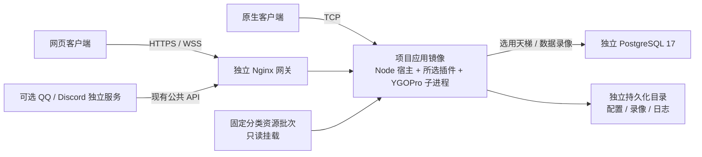

# Linux 固定镜像上线方案

状态：2026-10-13，`DESIGN_PENDING_CONFIRMATION`。本文是待确认方案，尚无可用的新镜像、
Compose 文件或容器部署命令。确认并实施后在本文补齐实际操作步骤，不另建一套重复的部署权威文档。
原生安装仍见 [Linux 安装](linux-install.md) 和 [Windows 安装](windows-install.md)；
共同资源、数据库、业务验收分别归 [resources](resources.md)、[database-init](database-init.md)、
[validation](validation.md)。本方案增加 Linux Docker 路线，不把它的结果代入 Windows 原生或 systemd 验收。

## 1. 推荐结果与当前基线

可以把 Node 服务端、匹配的原生 YGOPro 引擎和选定插件封装成项目自己的固定版本应用镜像。
PostgreSQL 和 HTTPS/WSS 网关分别运行；分类模板以独立固定批次挂载，避免每次改模板都重编引擎。
维护者新装只需取得经审核的发行包、填写私有配置、初始化或恢复数据、逐阶段验收，再开放入口。

当前代码核查结论：

| 项目 | 已有能力 / 缺口 |
| --- | --- |
| 旧 Docker | [归档原文](../../docs/archive/UPSTREAM_README.md) 提供上游镜像部署；根目录 Dockerfile 使用浮动来源，`.dockerignore` 排除整个 plugins；不能当作当前完整天梯发行包 |
| 宿主与引擎 | 插件在同一 Node 进程，YGOPro 是每个房间的子进程；不需要将两者拆成跨容器 RPC |
| 可选插件 | 缺失目录及 manifest 禁用已有支持；本地 config.enabled 是各插件自己的语义，不是统一卸载开关 |
| 分类资源 | 模板/元数据/展示文件的路径可配置为绝对路径；模板索引启动加载，更新模板需重启；两个 JSON 支持现有热读 |
| 两项无库 bug | postgres-compat 误重开数据库、ladder-web 缺服务仍注册路由已修复回归；服务器文件已备份更新、待用户重启生效；尚未公开发布 |
| 备份 | 当前正式停写检查依赖 systemd；须增加容器写入者检查，不能直接套用或以 isolated 参数绕过 |
| 证据 | 用户报告 Linux 编译及 base/706 启动通过，干净公共候选默认 prepare 官方下载通过；尚缺完整发行锁、规则等价和真实整服验收 |

基线来源仍按 [候选来源表](validation.md) 选择三仓审核后继。服务端公共 `6c8f070...` 尚不包含
本次本地 bug 修复与后续文档；真正打包前先确定包含已审改动的干净完整提交，记录实际全长 SHA。
不得把有未提交改动的本机 HEAD 写成公开发行来源。所有新增字段与命令在实施时定义并测试，本文名称为设计名称。

## 2. 运行组成与功能选择

网页游戏的静态包继续走现有 Cloudflare 流程，桌面助手仍是玩家 Windows 软件；不是放进应用镜像。
统计官网 HTML 属于 ladder-web 随该插件入镜像。机器人是另外的进程，可后续单独容器化，保留各自配置、
单实例锁和投递状态，不增加直接访问天梯表的路径。旧镜像的 WindBot 是对战 AI，不能替代 QQ/Discord 服务。

| 首轮镜像组合 | 所选插件与依赖 | 数据条件 |
| --- | --- | --- |
| basic-native | 不安装业务插件，保留空 plugins 目录 | 宿主 DB 关闭，原生对局；不承诺现有数据库录像归档/天梯/WSS |
| full | 当前十个插件及完整依赖闭包 | PG17、四语查询库、有效分类批次、完整天梯官网及录像能力 |
| custom | 显式列出插件 ID，机械展开依赖；重复 ID、循环或缺失入口拒绝 | 按实际能力核对 DB、查询库、分类和录像条件，不能仅靠 manifest 判断数据库需求 |

full 的十个 ID 是 `postgres-compat`、`card-catalog`、`deck-classifier`、`ladder-core`、
`ladder-analytics`、`ladder-usage-analytics`、`ladder-web`、`public-room-web`、
`public-replay-web`、`ladder-replay-enrichment`。`deck-classifier` 的实际目录是 deck_analysis。
custom 可覆盖已有提案的最小 ladder；初期凡启用业务数据库都沿用审核过的 20 表契约，省掉插件不自动删表。
public-room-web 可独立；public-replay-web 虽无天梯依赖，仍需要 DataManager，不能据空 dependencies 误判无库可用。

插件选择在构建时完成：镜像只含选定代码，启动不联网安装插件，不挂载整个可写 plugins 目录。
新增/卸载插件、更新插件代码都产生新镜像 digest；共享的引擎构建层可以复用。纯模板数据更新走第 4 节。
允许按实际需求构建 custom，不提前为所有组合维护镜像。

## 3. 固定版本与构建边界

首轮目标 Linux x86_64，优先 Ubuntu24.04 的固定 digest；构建和运行使用相同 glibc 基线。
Node24.15.0 从官方归档按 SHA 安装，编译工具和依赖使用可审查的软件源快照/包版本清单。
不将已测 Debian 引擎直接认作 Ubuntu 合格制品，也不混用旧 Alpine/musl 镜像与 glibc 二进制。
镜像标签是方便阅读的别名，部署一律锁定 digest；基础镜像、PG17 和 Nginx 同样记录 digest。
这些是本项目选择；固定摘要的依据见 [Docker 构建建议](https://docs.docker.com/build/building/best-practices/)。

采用独立 builder/runtime 阶段：

1. 从干净审核提交生成最小公共构建上下文，明确排除私有配置、SSH、玩家数据、dump、运行日志。
   不依赖旧 `.dockerignore` 的全插件排除，也不直接 COPY 整个有脏文件的工作区。
2. 用现有 engine-source 默认官方流程取得固定 YGOPro/Core/基础脚本/Premake/Lua，先验 SHA 再安全解包。
   固定卡池走既有 LFS 提交；覆盖层明确选择 base 或审核过的 706，分别生成不同镜像身份。
   官方下载应在实际构建网络与正常 TLS 下通过；不以离线包掩盖原流程失败。
3. 同 ABI 环境编译 SSE2 原生引擎，检查 ELF、ldd 和 SHA；组装后 verify/smoke。
   脚本、CDB、禁表一并封存，不把源码取得成功算作编译通过。
4. 服务端 npm ci、原始 build、全套测试；运行层保留构建产物、实际直接 require 的 JS、生产依赖、
   选定插件、许可证及引擎运行目录。maintenance-state.js 等原生文件不能被“只取生成 JS”遗漏。
5. 封存应用文件 SHA、引擎 manifest、插件 ID/依赖/文件 SHA、查询库指纹、基础镜像/工具链/npm lock
   与实际命令日志，输出镜像和发行元数据。插件普遍标成 1.0.0，不能单靠 manifest.version 识别代码。

运行时不编译、不拉 master/latest、不自动改 Lua 来源/版本/SHA/TLS。固定 digest 能重复部署同一制品；
仅锁标签或记录 apt 包名不足以证明重建产物逐字节相同。安全升级显式生成新发行包并重新验收。
首轮先输出本地 OCI/可搬运归档和 SHA；公共镜像推送另需授权与完整资产/许可证审查，现有 CDB 发布授权不涵盖整个镜像。

## 4. 分类模板与插件后续更新

数据批次包含 deck_templates/*.ydk、deck_analysis.json、deck_display.json 和批次清单，
记录全部文件 SHA、模板 ID/数量、格式和兼容的 classifier 代码身份。原文件格式和 ID 契约沿用现有
[分类模块说明](../../plugins/deck_analysis/README.md)，不引入数据库 ID 自动重写。

批次放到宿主独立目录并只读挂到应用的 `/assets/classifier`，通过插件本地配置指定三个绝对路径。
镜像保留可验证的默认种子；首次初始化只写全新批次目录，拒绝覆盖已有目录，不自动“补齐”未知数据。
挂载会遮蔽原目录内容，因此必须校验实际挂载后的资源，不能把空目录误认为已安装模板。
[Docker 挂载行为](https://docs.docker.com/engine/storage/bind-mounts/) 说明了遮蔽及只读挂载条件。

模板更新流程：

1. 在新目录构建批次，核对格式、ID、变体、重复卡计数、分类元数据与展示引用，验证代表卡组和模板下载。
   默认 full 必须具备预期模板；custom 如有意只用“其他”，须明确声明允许空模板，不能默默降级。
2. 进入维护，禁止新加入；等待房间和录像/结算任务结束，确认可停止，再停止应用写入者。
3. 保留旧镜像/旧批次/私有配置与需要的联合备份，将部署清单指向新批次的**实际目录**，重建应用容器。
   不在运行中逐个覆盖 YDK，也不只更改符号链接而假设容器已经切换挂载。
4. 检查实际加载批次、模板数量、分类和下载一致性，验证新对局的 G1 分类后恢复开放；失败则停写切回旧批次。

纯数据变更无需重编引擎/应用镜像，但必须重启 Node 重新加载模板。两个 JSON 的现有热读仍保留；
正式更新默认按完整批次切换，避免“内存旧分类、下载新模板”的混合状态。更新不自动重分类历史 Match、
改积分或清连胜；历史重分类工具仍须独立授权。变更分类算法/接口则更新插件代码及镜像，并验证旧批次兼容。
引擎脚本、卡池或禁表变更属于新引擎发行镜像及规则验收，不走分类模板挂载替换。

## 5. 新服务器首次上线流程

| 顺序 | 维护者操作 / 拟交付自动化 | 必须留下的结果 |
| --- | --- | --- |
| 1 取发行包 | 核对镜像/Compose/工具/源提交和资源清单，确认架构、组合、覆盖层及授权资产 | 实际镜像摘要与文件 SHA，不是文档示例 |
| 2 准备主机 | 安装受支持且记录版本的 Docker Engine/Compose；建立独立项目目录、网络、端口和权限 | 主机与守护进程检查，防火墙/容量/重启策略 |
| 3 配置与资源 | 校验私有配置、固定分类批次、查询库、实际 HostInfo/协议/禁表；配置 stop 和独立维护账号 | 保密输入只记录校验结论，不打印连接串/密码 |
| 4 数据库 | 启动独立 PG17；空库路线显式运行已有 init/grant/verify；有数据路线校验恢复包并恢复新库/新目录 | synchronize=false、20 表、runtime DML/DDL 拒绝、序列与恢复验收 |
| 5 应用维护启动 | 依赖 PG 健康及显式前置检查成功，校验实际插件服务，再开放内部监听 | 所选组合满足依赖；core 可无库，full 不得降级成只有 TCP 的普通服 |
| 6 网关与三端 | 配 TLS/DNS/Origin/真实 IP；网页按三个正式公开值构建，桌面生成受控包，绑定同一制品锁 | TCP/WSS/HTTPS、资源身份、实际前端产物和客户端参数一致 |
| 7 业务与恢复 | 按现有真实业务矩阵执行对局、结算、录像、usage、旧裁定对照及联合恢复 | 全链路证据；任何 synthetic fixture 不算正式签认 |
| 8 重启与异机恢复 | 真实 Linux 主机重启验证 Docker/PG/app/gateway 顺序；复制备份到另一主机恢复并复查 | 数据保留、权限、重连、可写性、离机回执 |
| 9 放行 | 审核依赖风险、实际域名/权限/备份与全部阶段回执，解除维护开放 | 对应容器路线的真实 gate；生产切换另行授权 |

Compose 的 running 不等于服务可用；PG 健康检查、前置任务成功与应用业务就绪分别检查。
参考 [Compose 启动条件](https://docs.docker.com/compose/how-tos/startup-order/)。拟增加通用组合守卫：
初始化完成且监听前确认必需插件及 ladderCore/两个 analytics/classifier/cardCatalog 等服务与实际元数据。
本次 ladder-web bug 修复只避免失效路由，不代替 full 的启动拒绝/就绪守卫；独立可选插件继续遵守既有故障隔离。
DB 故障、必需插件失效、错误资源、空挂载和混配镜像都应在开放前被拒绝，不能仅看 Plugin loaded 或端口监听。

应用以固定非 root 用户直接 exec Node，使用 init 管理子进程，避免 npm start 的日志管道成为信号转发中间层。
默认只读根文件系统、去除多余 capabilities、tmpfs 临时空间、日志轮转；私有主配置目录须可写，
因为宿主会创建/更新配置。提前建立空 plugins 目录；tournament 的 deck/replay/log 及 deck_log 路径
即使功能关闭也可能在启动时创建，必须显式初始化和挂载。通过实际对局发现其余写路径，只开放必要目录。
不挂载 Docker socket，不启用 privileged。不可用“整个应用目录可写”解决权限错误。

数据库端口不公开；应用 HTTP/维护端点默认仅内部或宿主 loopback，公网仅审核过的游戏 TCP 和网关 443。
Nginx 的管理路由拒绝、Origin 精确白名单、覆盖客户端伪造的转发头沿用已有模板；容器网络需显式配置
实际网关地址/受控 CIDR 为可信代理，不能照抄 127.0.0.1 或信任所有来源。WSS 长连接超时、IP 和移动端真机单独验收。
PG 私密字段通过现有私有配置/受控 secret 文件提供；不烘焙入镜像，不将密码放入公开 Compose 或构建参数。
目前没有自动 SIGTERM 排空保证，必须先维护排空再停止；异常终止/重启时子进程清理与不重复结算须实测。

## 6. 备份、升级与回退

沿用 [联合备份恢复](backup-restore.md) 的库内容/序列/schema/文件 SHA/录像关系校验。
新增容器停写后端，默认 systemd 后端保持兼容。宿主运维工具按受控 Compose 项目/服务/容器身份
核对已停止、无重启中的写入者，拒绝身份不明或仍在运行的实例；应用容器不获得 Docker 控制权限。
所有同库外部任务/机器人与另一实例均列入写入者清单，同时保留数据库无其他连接和复制前后内容稳定检查。
现有 isolated 模式只用于明确的合成演练，不能当作正式容器停写证明。

备份包含 DB dump/权限映射、录像与已声明运行数据、私有配置、镜像 digest/可恢复镜像归档、组合清单、
分类批次与引擎/查询指纹；受保护保存和异机复制，不能提交玩家数据到 GitHub。
无库组合另有文件恢复校验，不用“无数据库”冒充完整天梯数据库恢复通过。

升级先在隔离环境验证新镜像及资源，维护排空、停写并联合备份，再切换唯一应用实例；启动前核对 schema。
普通启动不自动迁移、删表或回填。兼容升级可停止后恢复旧镜像/旧批次/配置；涉及不兼容 schema 时，
恢复到新名字数据库和新目录再切换，明确恢复点及升级后写入的数据损失窗口，不能直接倒灌覆盖正式库。
不默认运行删除持久化卷的 down -v，不保留两个实例同时向同库写入。

## 7. 实施包与验收

| 工作包 | 确认后交付 | 验证重点 |
| --- | --- | --- |
| D1 固定构建 | 模块化构建上下文、镜像 builder/runtime、组合选择与依赖清单、发行元数据 | core/full/custom；原生编译/依赖/SHA；缺插件与坏依赖拒绝；无私密内容 |
| D2 分类批次 | 初始化/校验/切换工具、兼容与 SHA 清单，沿用插件配置路径 | 缺文件、未知/空目录、错 ID/变体、分类/下载一致性、重启与回退 |
| D3 安装启动 | Compose、非 root 权限、前置检查及监听前组合守卫、网关配置 | 空库/恢复两路线、DB/资源/服务拒绝、TCP/WSS/真实 IP、正常独立插件 |
| D4 运维恢复 | 容器写入者后端、日志/容量/成功备份监控、联合恢复与升级回退 | 未停写/未知身份拒绝，复制批次完整校验、离机恢复和重启 |
| D5 跨制品验收 | 扩展 deployment lock/gate 的容器路线和实际组件能力 | 完整 TT 九阶段业务条件保持；core/custom 的 N/A 有真实功能依据，不能豁免 full |
| D6 操作手册 | 在本文补具体可执行命令，索引现有权威专题，补实际容器架构图 | 陌生维护者在全新主机完整执行，明确私密输入提供者与证据位置 |

CI 首轮只构建/测试/生成受控制品，不自动推镜像或上线。需要真正的 Linux Docker daemon、构建出站网络与
官方来源 TLS/代理信任；仅 Dockerfile 静态检查、npm 测试或临时 TCP 启动不算容器整服通过。
Codex 云端若缺 daemon/受限构建权限，明确记录 BLOCKED，改在有 Docker 的受控 Linux 验证主机执行，
不能用本机 Windows 模拟替代。官方 Lua 已恢复的环境配置还需验证传入实际构建网络，不能据主任务下载成功假设 builder 可访问。

人工验收继续包括真实 TT 三局/换备/积分历史/连胜/录像/usage、旧正式引擎规则对照、双客户端/手机、
真实 WSS 长连接与 IP、主机 reboot、异机恢复及最终安全/迁服回执。Linux 容器运行成功不证明 Windows 服务/原生引擎可用。
目前这些结果不能标通过；Docker 路线通过后也不会替未执行的原生 systemd 路线填 PASS。

## 8. 待确认范围

建议确认 D1 → D6 的本地实现与隔离测试，以 basic-native/full 两个默认组合及 custom 选择为入口，
使用“应用固定镜像 + 独立 PG/网关 + 分类资源固定批次”结构。数据目录、正式域名、可信代理、密码和签认
由部署负责人审核提供，缺少时明确阻塞，不填示例值替代正式输入。

方案确认仅授权代码、文档、构建和隔离验证；不含生产连接/数据库覆盖/规则改变、公网镜像发布或正式迁服。
固定引擎来源的生产行为等价、全部可分发资产、构建主机条件及人工验收仍须取得真实证据。
