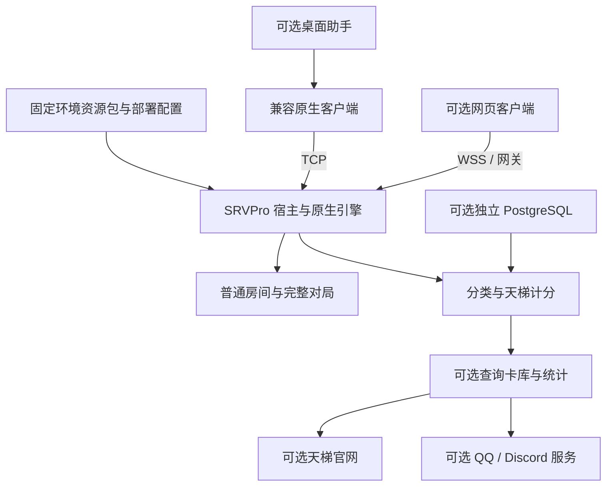

# 第三阶段：其他怀旧环境复用与解耦方案

状态：2026-10-12 更新评估与提案，**待用户确认，尚未实施**。本文覆盖服务端、网页与桌面助手；
不是已经可执行的新环境部署教程。现有部署命令仍以 1103/706 完整环境为目标。

第二阶段的工具与指南交付，以及 Linux/PG17 隔离基础验证已完成，依据见
[云端报告记录](cloud-validation-20261011.md)。完整新机开服与真实迁服验收仍待固定在线引擎制品、
实际资源加载和完整对局验证；第三阶段当前只进入方案评估。应先建立可复现的 1103 基准，再验收新环境。

## 1. 结论与改造难度

三个项目已经有可复用的模块边界。建议继续维护现有代码仓库，把规则与卡池差异放入固定版本的
环境资源包，通过部署配置选择功能。无需为每个环境复制一套长期维护的业务代码，也无需先拆成微服务。

| 目标 | 当前情况 | 预计难度及原因 |
| --- | --- | --- |
| 同协议、兼容引擎，仅开普通原生对战 | 宿主有无数据库启动分支；资源与安装仍需人工准备 | 低至中等：主要是引擎封存、功能选择和预检 |
| 同协议、新卡池，带天梯与统计官网 | 大部分业务可复用，模板、示例、文案和统计边界需要独立配置 | 中等：环境内容准备与真实结算验收不可省略 |
| 同协议、新卡池，带网页在线对战 | 服务器地址已配置化；资源生成仍固定 1103 | 中等：需要环境资源构建及兼容校验 |
| 再提供网页离线录像回放、桌面自动安装 | 固定 706 回放资源和桌面脚本策略尚未配置化 | 中至高：规则资源一致性、安装恢复和真实客户端验收 |
| 不同消息协议、Core API、场地布局或录像格式 | 版本号配置不能兼容新的消息结构 | 高：需要单独的协议/UI/回放适配工程 |

这里的难度是修改范围评估，不是已经测得的工期。卡池名称、禁表或协议版本号改成功，不能证明旧裁定正确。
第一轮建议限定为**与现有宿主及客户端协议兼容的环境**。

## 2. 可以拆出的最小部件

| 部署组合 | 必需部件 | 当前限制 |
| --- | --- | --- |
| `basic-native`，拟新增 | Node 宿主、匹配的 Linux 引擎/Core/Lua/卡库/禁表、兼容原生客户端 | 不承诺无库服务器录像归档；当前部署工具尚没有此组合入口 |
| `basic-web`，拟新增 | 普通服、Neos/WSS、网关/TLS、目标环境网页显示资源 | 必须验证协议相容；现有网页构建仍无条件检查固定回放资源 |
| `ladder`，拟新增 | 普通服、独立 PG、deck-classifier、ladder-core | 当前天梯强依赖分类服务；初期不能直接省掉 classifier |
| `full`，拟新增 | 天梯、card-catalog、两个 analytics、ladder-web，以及选择的录像功能 | 机器人另行启用，不作为开服前提 |

名称用于说明提案，不是现有命令参数。原生客户端直接连 TCP，不要求安装桌面助手。
`public-room-web` 已能独立提供房间 API；`public-replay-web` 虽无天梯插件依赖，当前仍要求 DataManager。
宿主录像持久化也受数据库开关约束，因此“普通服不带 PG”与“保留现有服务器录像网站”不能同时直接承诺。

若只开基础天梯，可先提供有效的分类元数据与展示文件，保留“其他”分类，模板集允许为空，
使全部卡组暂归“其他”；后续再补经审核的分类模板。
第一轮保留共同的 `4095`“其他”类型契约，并在环境校验中明确检查；目前 usage、页面和月报仍有此常量。
允许任意 `otherDeckTypeId` 会扩大消费者/API 和数据迁移范围，留待实际需求出现后统一实现。

## 3. 当前需要解开的依赖

| 位置 | 已有能力 / 绑定内容 | 建议修改及原因 |
| --- | --- | --- |
| 宿主与 plugin-system | 默认发现一级插件目录，manifest 中 `enabled:false` 会在加载代码前剔除；其余按依赖加载 | 发现机制本身不是 bug；增加部署组合与插件选择入口，使新环境无需修改被 Git 跟踪的 manifest |
| `ops/scripts/ops.py` preflight | 固定要求两套引擎 CDB 和四语 catalog | 按所选功能与环境声明检查；普通服不会因不需要的统计资源而被拒绝 |
| `ladder-web` | 强依赖分类及两个 analytics；公共页面一起受影响 | 如启用普通官网，将公共静态页面宿主与天梯页面组合分开，继续放在同一个 Node 进程 |
| 分类 / 提示 / 示例 / 机器人 | 分类文件位置部分可配，内容和多处四语品牌文案固定 1103 | 用环境内容生成公开页面和消息，保留原模块服务契约 |
| 网页部署参数 | WSS、官网地址和交接 Origin 已配置化 | 沿用现有参数，显式填写新实例地址；不重做已有联机配置 |
| 网页资源与回放 | 固定环境 ID、5267 卡池、禁表 hash、706-v1 及 0x1362 | 资源构建读取环境描述；在线协议和离线回放分别验证，旧裁定覆盖脚本可为空或来自其他审核来源 |
| 网页本地存储 | 同 origin 的卡组、录像和部分设置共享库 | 优先独立 origin；若需共用 origin，再加环境 namespace 和显式旧数据导入 |
| 桌面助手 | TCP/API/EXE 可配，但安装目录、5267 校验、706 脚本来源和注入策略固定 | 独立的可选旧裁定安装器与资源 manifest，允许无覆盖或替代来源；保留事务、路径约束、备份及冲突检测 |

插件本地配置中的 `enabled:false` 不是宿主统一禁用开关，各插件自行解释；不能与 manifest 的禁用混用。
本次源码核查还发现两项具体的无库部署缺陷，应在第 1 批处理，而不将扫描目录本身当作 bug：

- 旧连接为 PostgreSQL 时，`postgres-compat` 即使未启用自己的连接且宿主数据库开关为 false，
  仍会把宿主开关改成 true。应保留旧连接的安全策略，但尊重明确关闭数据库的意图；适配器显式启用的情况另行定义。
- 天梯和 analytics 在无库时不提供服务，宿主仍将其记作 loaded；`ladder-web` 未检查服务便注册统计路由，
  `/api/ladder` 会返回 500。应让未启用的业务路由不注册，并按所选功能检查实际服务可用性。

以上仅基于源码及合成参数核查，不代表当前正式配置触发了这些条件；本轮不修改运行代码。

源码依据集中在 `ygopro-server.coffee`、`plugin-system.js`、插件 manifest 和 `ops/scripts/ops.py`；
网页的 `src/variant/`、环境资源脚本与 `src/replay/`；桌面的 `src-tauri/src/environment.rs`、
`scripts.rs`、`game.rs` 及便携包脚本。既有 [卡池适配清单](../../docs/CARD_POOL_PORTING_GUIDE.md)
仍可用于人工审查，不代表环境包自动安装已经存在。

## 4. 环境描述、资源与私有配置

拟新增一个有版本校验的公共环境描述，建议包含以下内容。具体字段在实施时确定，并先导入现有 1103，
默认选择及现有公开资源字节保持兼容。

| 内容 | 应记录的身份与约束 |
| --- | --- |
| 环境身份 | 稳定 environmentId、不可变 revision、四语名称、规则时间点、说明与可选社区链接 |
| 兼容性 | 已支持的协议适配器 ID、联机版本、Core/ABI、客户端兼容范围、经验证的 Single/Match 等能力 |
| 引擎包 | 固定下载来源、架构、SHA；Core、必需基础 Lua 的身份；必需文件及实际角色，旧裁定覆盖层单独声明 |
| 旧裁定覆盖，可选 | 可为空；启用时声明独立资源 ID、任意受支持且审核过的来源、固定提交/制品 SHA、文件范围、加载顺序及兼容范围 |
| 卡池与禁表 | 引擎卡库、允许卡池、禁表身份/hash；全量卡库中的可用卡与本环境允许卡明确区分 |
| 显示和查询数据 | 网页四语显示包与全量 card-catalog 各自的固定 revision/指纹、目标允许卡号覆盖情况 |
| 业务内容 | 分类元数据/模板、示例卡组、提示、默认房名与天梯入口、展示文案 |
| 回放，可选 | 单独 replayProfileId、录像格式/版本、Core/基础 Lua/可选覆盖/CDB/WASM/工具链及各自 SHA |
| 桌面，可选 | 客户端类型、资源相对路径、托管范围、固定脚本提交/子目录与 bootstrap 策略 |

域名、端口、数据目录属于实例部署配置；DB 密码、管理员和机器人凭据继续放私有配置。
资源 revision 不应因搬域名而变化。未知适配器或不匹配资源应在监听前拒绝；环境描述不能加载任意远程 JS。

### 旧裁定脚本独立为可选层

基础 Lua 是引擎运行资源；旧裁定覆盖、`special.lua` 注入及当前 706 的 utility 拼接策略是另一层。
按用户要求，其他环境不强制配置旧裁定，也不强制使用 `301zrg/specials` 或其 `706` 子目录。
拟提供三种明确选择：

1. 无旧裁定覆盖：只用目标引擎匹配的基础脚本，不下载当前旧裁定仓库、不做该仓库的注入。
2. 当前 706 覆盖：仅由现有 1103 描述显式启用，保留其已核验的加载与客户端策略。
3. 其他覆盖：由新环境指定审核过的固定 Git 提交、发布制品或本地封存包；不假设拥有同样的子目录、
   `special.lua` 或 utility 拼接结构，校验其兼容范围及 SHA。

此选择贯穿服务端资源准备、网页回放资源生成、桌面下载/安装及指纹检查；不依赖天梯是否启用。
普通服和完整天梯服都允许没有覆盖层；“关闭”表示不校验、不下载、不安装该可选层。
旧覆盖已安装时，应按托管清单及事务恢复到干净基础，检查本地修改冲突；不能只改布尔值而留下仍会加载的旧文件。
关闭覆盖也不等于 Core 自动变成另一年代规则，目标 Core 和基础脚本仍需按该环境实际规则审核。

现有四份 Git LFS CDB 是**查询库**，并不能替代在线引擎、允许卡池或浏览器回放 Core。
2026-10-12 已确认现服只加载 5,267 卡的 cards.cdb，cards1.cdb 未生效。
现用小库已独立 LFS 发布；安装不要求 inactive 大库，历史原件仍保留在原服和私有备份。
固定输入、可选覆盖与双系统组装归属 [第二阶段引擎指南](ygopro-install.md)；不因此启动本提案的运行代码解耦。

建议保持每个部署实例的 `ygopro/` 等现有相对目录，先通过独立目录或发布链接切换资源，
避免为“可移植”而全面重写引擎路径。

## 5. 实例隔离与恢复边界

每个环境使用独立部署目录、端口、录像目录、私有配置、机器人状态和数据库。
多个数据库可由同一 PostgreSQL 服务管理；当前部署工具使用固定 `public` schema，初期要求独立 database，
不承诺单库多 schema。带 PG 的组合初期沿用完整 20 表初始化与验收契约，不按功能裁剪表；
普通无库组合不运行数据库初始化。站点优先使用不同 origin；仅换 URL 路径无法隔离浏览器存储。

环境 ID 与资源 revision 进入发布摘要和备份清单，恢复前检查目标身份。
同一环境迁服继续复用联合恢复工具；跨环境不自动沿用积分、分类 ID、统计、连胜或录像解释规则。
已由可信会话或配套清单绑定的录像保留生成时资源身份，错配拒绝。
录像头不含 Core/Lua/CDB 摘要，未知来源不能仅凭 `0x1362` 自动识别环境；保留原件，
要求用户明确选择已经验证的回放环境并提示来源未确认，缺卡、脚本错误或响应不一致时停止。
缺匹配回放包时可以存储或下载原件，不能自动套用另一个环境重演。

桌面一份游戏目录同一时刻只有一个活动规则环境。不同 Core 优先分目录安装；
现有用户卡组和录像不清理，安装失败、恢复和切换过程继续检查本地文件冲突。

## 6. 分批实施方案

### 第 0 批：建立可复现的现有环境基准

按第二阶段新增流程审核固定 706 候选引擎制品与指纹，验证 Lua/旧裁定和真实行为；现服 CDB 加载身份已确认。
用隔离 Linux 运行 ELF/ldd/SHA preflight、原生 TCP/WSS 和完整普通/TT 对局，记录资源身份。
封存来源和公开发布范围另行确定；本提案不上传本地整个 `ygopro/` 目录。
这一批是开服验收前置条件，不能用四语查询库通过代替。

### 第 1 批：最小普通服与完整天梯服

1. 引入环境描述校验与部署组合；没有新增选择时保持现有 1103 完整行为。
2. 增加插件启用集合与依赖检查，普通服不加载数据库/天梯/统计功能，完整服保持原契约。
3. `ops` 按组合取得固定资源、预检和输出部署摘要；旧裁定覆盖作为独立可选组件，基础脚本仍必需。
   处理上面的数据库开关及无库业务路由条件缺陷，保留文件指纹、路径边界、空目标保护及错误拒绝。
4. 发布/备份摘要带环境身份；拒绝恢复到不同环境，不自动改生产数据库。
5. 如第一批需要普通官网，再拆公共页面宿主；无库录像归档作为单独能力需求，不能顺带声称已实现。

这一批不改对战消息队列、动画顺序、结算公式或原环境数据。此前用户决定不实施的 B 继续保留。

### 第 2 批：兼容协议的网页在线环境

环境资源生成/还原/快照/打包读取同一份描述，1103 的专用清洗规则只用于 1103。
替换固定环境 ID、标题、卡池提示及默认房名，保留普通房实际 HostInfo 的解析。
增加功能选择，使未验证的离线回放既不加载也不成为构建必需资源；不能仅隐藏回放按钮。
默认独立站点 origin；需要同 origin 时，给新环境 namespace 并提供显式导入，保留 1103 原库。

在线版本 `0x1362` 对应具体消息格式。更改数字或 `alternative_versions` 不能支持新布局；
不同协议必须新增受控适配器和真实样本验证。

### 第 3 批：环境统计内容、回放与桌面便利功能

先更新分类模板、示例、四语文案和可选机器人；需要不同于 TT 的模式代码时再统一消费者。
网页离线回放单独封存 Core/基础 Lua/所选可选覆盖/CDB/工具链，使用合成原生录像逐检查点对照；未经验证先关闭重演。
桌面资源下载改为固定提交/指纹，旧裁定安装入口和来源独立可选；无覆盖环境无需访问当前脚本仓库。
环境安装状态与备份带身份，避免追随 master 与服务器规则不一致。
保留既有安装事务与恢复能力，再做 Windows 真机验收。

### 第 4 批：第二个环境示范与最终指南

由用户确定一个同协议怀旧环境及其规则来源。先完成原生普通服，再选择网页、天梯、回放和桌面能力。
用第二个环境证明新增环境只需要准备数据与配置，不必改通用业务源码；合成 profile 只能证明机制，
不能替代真实规则资源和对局验收。

实施及验收后编写可执行的“其他环境部署指南”，覆盖最小安装、可选能力、资源封存、升级回退、
联合备份与恢复。初期不同协议扩展不计入“快速开服”承诺。

## 7. 验收条件

| 范围 | 有区分度的验收 |
| --- | --- |
| 最小服务 | 无 PG、无天梯/analytics、无查询 catalog，真实双客户端完成普通对局；缺必需引擎资源则拒绝 |
| 完整旧环境 | 1103 资源 SHA、TT、换备、观战、重连、结算、录像和使用率保持；原私有配置仍可使用 |
| 环境校验 | 未知组合、缺插件依赖、资源 SHA/协议/禁表不一致时拒绝；manifest 禁用模块不执行；完整组合仍检查查询库 |
| 数据库与无库降级 | 明确关闭数据库且保留旧 PG 连接字段时不重新启用；无库不暴露调用缺失服务的统计路由 |
| 可选旧裁定 | 无覆盖及替代来源两种新环境都通过；无覆盖不访问当前旧裁定仓库、不注入遗留脚本；启用覆盖时固定来源/顺序/指纹一致，移除时无残留 |
| 规则与内容 | 新环境允许/禁止卡组、禁限数量、关键旧裁定、分类模板、四语页面和机器人符合该环境 |
| 数据隔离 | 不同 database/录像/机器人状态无串用；错误环境恢复拒绝，旧统计不跨环境导入 |
| 网页 | 环境资源及公开参数一致；卡组/录像/缓存隔离且旧用户数据保留；完整在线对局验收 |
| 回放，可选 | 可信绑定错配拒绝；未知来源不自动识别；原生与浏览器重演场地检查点一致，错误时停止 |
| 桌面，可选 | 两种受支持客户端安装/启动/恢复、断电恢复、本地修改冲突和分目录环境切换通过 |
| 部署与文档 | 第二个环境按指南从空目标完成安装、备份恢复及回退；正式 systemd/网络与真机另行验收 |

实现后按实际改动执行测试。现有构建与单元测试通过不能代替引擎规则、动画、原生客户端及生产验收。

## 8. 仓库与确认范围

建议将指南继续放在服务端 `ops/docs/`，三个项目各自保留模块说明并链接到共同运维入口。
公开卡库和审核后允许发布的环境资源继续使用
[srvprotianti-resources](https://github.com/301zrg/srvprotianti-resources) 的固定提交与指纹。
源码与指南随版本一起审查，暂不新增独立文档仓库。

建议第一轮确认**第 0、1 批：基准引擎封存与验证、环境描述、最小/完整部署组合、功能感知预检和环境隔离**。
随后再确认网页与桌面批次。用户确认之前只交付本方案和第二阶段验证记录，不实施运行代码解耦。
引擎制品来源、可公开内容和第二个环境选择，需要在对应实施批次明确。
