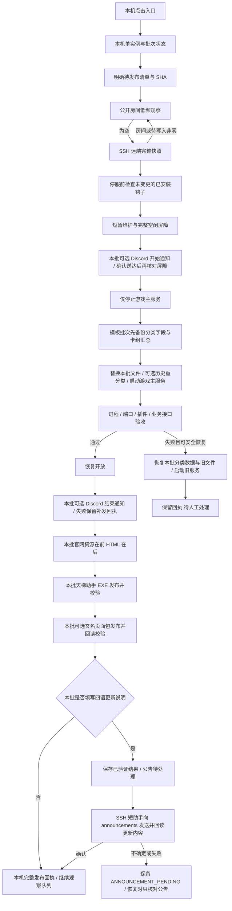

# Windows 本机发布监控

本工具把既有一次性空房重启流程整理为可复用入口。用户在自己的电脑打开 PowerShell 窗口，窗口持续观察并处理明确排队的批次；服务器仅在切换时运行短协调进程。没有 Windows 开机任务或服务器常驻监控服务。

范围为游戏后端、官网页面、天梯助手。Cloudflare 网页对战端不纳入本工具。

## 当前电脑入口

当前工作区的 `server-release-monitor/` 保存无凭据连接配置、`queue/<批次>/manifest.json`、候选文件与运行状态；不把整目录提交或公开。
根目录的“启动服务器发布监控.cmd”打开 `ops/windows-release-monitor/Start-ReleaseMonitor.ps1`。
用户点击后开始监控；制作清单、导入模块、测试和预检均不会提前重启。

窗口中显示房间数量、当前批次和阶段。没有待发布批次时继续低频观察；关闭窗口停止本机观察。
已启动的服务器短协调进程负责完成自己的切换或回退，关闭窗口不会强杀它。再次打开窗口先核对远端状态，避免重复重启。

## 发布数据流



上传时，已存在的远端批次目录必须连同 `manifest.json` 与本机记录逐字节一致，否则拒绝复用。启动时，`launch-once.ps1 -ManifestSha` 和协调器的 `--manifest-sha` 再核对一次同一清单 SHA；正式运行缺少该参数或 SHA 不符时，在取锁、写回执之前就停止。旧批次的远端控制文件保持原样，不重新上传。

静态页面或助手单独发布的批次不需要重启游戏服务，不为静态文件等待空房。
所有涉及后端重启的批次都要检查完整房间和待完成任务。公开房间接口会过滤部分房间，公开数量为零只能触发检查，不能作为停机许可。

## 清单与文件边界

普通批次继续使用 `schemaVersion=1`；含模板历史重分类、Discord 维护通知或更新内容公告的批次使用 `schemaVersion=2`。
批次 ID 仅允许小写字母、数字和连字符，不重复使用已完成批次 ID。
`files` 逐项声明正式相对路径、批次内 source、目标 SHA256、预期旧 SHA256、阶段 `backend` 或 `website`。
旧 SHA 为 null 表示目标必须原先不存在。实际目标或备份散列不符就停止，避免覆盖他人后续改动。
官网文件只接受官网目录内路径，按资源后 HTML 的顺序替换。清单不接受任意 shell 命令。

助手字段为 `desktop: {repository, tag, targetCommit, workflow, asset: {name, sha256?}}`，
例如 workflow 使用现有 `windows-desktop.yml`、ZIP 名称使用 `srvprotianti-desktop-windows-x64.zip`。
`targetCommit` 固定 40 位提交 SHA；工具核对 package、Tauri、Cargo 三处版本与标签一致。
后端/官网验收后才创建该标签，沿用现有 CI 构建和发布；不新建第二套 Release 上传链路，
不自动合并源分支，也不移动已存在但指向其他提交的同名标签。
已有相同版本正式包会被重新核对后视为完成；创建标签响应不确定时先读取实际标签，避免重复操作。
新版本默认最多等待 90 分钟；正式 ZIP 下载散列须匹配 GitHub 资产 digest，
清单还可指定额外 SHA。CI 重新构建 ZIP 时字节可能不同，因此未提供额外 SHA 时以本次正式资产 digest 核验。
API 参数依据 [Git references](https://docs.github.com/en/rest/git/refs?apiVersion=2026-03-10)、
[workflow runs](https://docs.github.com/en/rest/actions/workflow-runs?apiVersion=2026-03-10) 与
[release assets](https://docs.github.com/en/rest/releases/assets?apiVersion=2026-03-10) 的官方文档。

助手可额外声明固定页面制品，格式如下；未声明 `pages` 的旧批次行为保持兼容：

```json
{
  "pages": {
    "publisherRoot": "F:/reviewed/desktop",
    "websiteRoot": "F:/reviewed/server/plugins/ladder-web/web",
    "manifest": {"source": "pages/stable.json", "sha256": "<64 位小写 SHA256>"},
    "archive": {"source": "pages/srvprotianti-desktop-pages.zip", "sha256": "<64 位小写 SHA256>"},
    "publicKey": {"source": "pages/public-key.json", "sha256": "<64 位小写 SHA256>"}
  }
}
```

`pages` 位于 `desktop` 内，仅支持现有 `301zrg/srvprotianti-desktop` 发布器。
两个根目录必须是绝对 Windows 本地目录；三个制品 source 均为批次内相对路径，
实际文件路径也必须留在批次目录内，不接受目录联接逃逸、重复文件、未知字段或未固定 SHA。
ZIP 上限 20 MiB，manifest 上限 1 MiB，公钥上限 16 KiB。
`pages` 可选 `sourceCommit`，值必须是完整小写 40 位 Git 提交 SHA；省略时沿用 `desktop.targetCommit`。
`desktop.targetCommit` 始终标识现有 EXE 标签，`pages.sourceCommit` 只标识本次页面来源提交，
并用于签名中 `sourceCommits.desktop` 与发布器的 `--commit`，不移动 EXE 标签或触发新版 EXE。
两者不同时，两个提交的整个 `src-tauri/` 树必须相同，不能借页面更新改变原生代码、配置、依赖、权限或信任根。
`publisherRoot` 的 Git HEAD 必须等于页面来源提交，发布器及其两个校验模块、`web-source`
和嵌入公钥不能含相关未提交改动，发布器、来源清单及公钥必须已提交。
批次公钥还必须与该 EXE 提交内的公钥相同。

停服前，隐藏子进程复用现有页面发布器的全部本地门禁：签名、ZIP、来源提交、实际官网 Git blobs、
生成源文件以及签名内 `source-manifest.json` 字节；到第一次凭据请求时即停止，不读取凭据、不发送网络请求。
通过后才进行已有 EXE 的只读 GitHub 预检；含页面的批次即使 EXE 已发布也必须具备 GitHub 认证。
正式阶段先下载并校验 EXE，随后调用固定提交中的 `scripts/publish-page-package.mjs`，
发布不可覆盖的 `pages-v<版本>` 制品并回读 `page-updates/stable.json`。
发布器保留应用 Release 为 latest；监控器还核对返回的 latest 应用版本等于本批 EXE 标签，
页面制品散列等于清单。EXE 已存在也不会跳过页面阶段。
EXE 通过但页面尚未成功时，独立助手回执为 `EXE_VERIFIED`，页面成功后才为 `PUBLISHED`；
未声明更新内容公告时，监控批次在两项均成功后写入 `COMPLETE`；声明了公告则继续执行下述公告阶段。

页面子进程使用参数数组、`shell=false`、隐藏窗口、最多 128 KiB 输出，预检最多 2 分钟，正式发布最多 10 分钟。
错误仅保留安全原因码，不保存子进程输出或凭据。网络不确定、限流、认证失败和超时保留
`SERVER_DONE`，恢复时重新核对同一 EXE 与页面状态，不再次触发服务器；签名、来源、散列、标签或序号冲突则停止待核对。

候选文件由维护者在构建、测试和复核后加入队列。工具不扫描未提交文件、合并分支或选择“最新代码”代替明确发布意图。
空后端/官网/助手全部缺失的批次无效。完成、回退和状态不明的批次都不会被自动当作全新批次重放。
长上传校验清单采用受长度限制的压缩 PowerShell 参数，避免 Windows SSH 默认 shell 的命令行上限；
压缩后仍超限时明确拒绝，要求拆分批次，不以省略 SHA 校验绕过限制。

运行配置、凭据、手动封禁、玩家积分、引擎与其他服务不在文件部署范围内。
AFK/flee/Zombie 历史清理是另行授权且已执行的一次性操作，不加入常驻流程。

### 模板重分类与维护通知

版本 2 清单可增加以下显式字段；不声明时不访问数据库或 Discord：

```json
{
  "schemaVersion": 2,
  "deckReclassification": {
    "beforeTemplateSha256": "<正式模板集合的 SHA256>",
    "templateSha256": "<候选完整模板集合的 SHA256>"
  },
  "notifications": {
    "kind": "deck-templates",
    "guildId": "1504410444876484658",
    "channelId": "1554786350845141002",
    "botRoot": "C:/srvpro-runtime/discord-bot"
  }
}
```

两个 SHA 使用 [手动重分类工具](../../plugins/deck_analysis/RECLASSIFY_DATABASE.md) 的完整模板算法，
包括文件名和多模板变体。发布仍逐文件检查新旧 SHA；同批应带上当前重分类工具，
远端预检以正式依赖加载该候选；同批声明的分类器候选使用独立模块缓存，不提前替换或污染正式模块。
异画归并等分类语义变化的新批次应另填 `deckReclassification.classificationSha256`，对应重分类报告
`classification.sha256`（算法版本、实际卡库指纹和完整模板 SHA 的组合）。目标探测和三阶段报告都核对该值；
字段对旧批次仍可省略，旧清单和回执不重写。异步卡库装载失败时预检中止。

`deck-maintenance.cjs` 在游戏停服后备份 Match/单局/使用率样本的分类字段，以及卡组日/总汇总，
备份不保存玩家名称或牌组 buffer。按 `audit → simulate → apply` 执行既有工具，
全部不一致项为零才启动服务。重分类使用可靠 G1，缺失记录保留原值并报告；不修改积分、胜负或封禁。
模板、数据库身份、原始事实和分类字段的摘要共同约束操作，拒绝在额外写入或漂移后覆盖数据。

私有快照、模拟/提交报告与一次性回执留在服务器批次的 `deck-maintenance/`，不传回原始行。
失败回退在保持维护和停服时先恢复本批分类数据，再恢复文件和旧服务。
事务提交结果不明确、已提交但回执失败、数据库漂移或恢复失败时保持维护并停止自动恢复，
不能把报告缺失解释为未提交，也不能只恢复旧模板后开放。已尝试过的重分类批次不能自动重放。
回退完成后，新的最终回执会刷新 `deckReclassification` 为恢复后的状态；旧批次如仍保留回退前 `applied` 快照，以其独立 `rolled-back.json` 和恢复摘要为准，不改写旧回执。

通知沿用当前服务器 Discord Bot 的 REST 和 loopback 代理，不启动第二个 Gateway 实例。
新批次使用 INFORMATION / `#announcements`（`1554786350845141002`），成员可阅读，站主、管理员及机器人发布；`#server-status` 保留实时状态卡，`#general` 用于聊天。
通知种类为模板更新 `deck-templates` 或普通服务更新 `server-update`，均使用固定四语言文案，不接受任意目标或文案。
普通后端更新只需声明 `schemaVersion=2` 和上述 `notifications`，将 `kind` 改为 `server-update`；无需声明 `deckReclassification`，也不会访问业务数据库。
预检核对精确的服务器/频道 ID、`announcements` 名称、普通文字频道类型、机器人身份及查看/发送/历史权限，不发消息。
维护通知和更新公告都借用游戏服务器上的 Discord 机器人：要求它在线、位于固定目录 `C:/srvpro-runtime/discord-bot`，并从该目录的私有配置读取 Token。连到 Discord 的路线跟随机器人自己：它的 PM2 环境里有 `DISCORD_PROXY_URL` 就走同一个本机 loopback 代理，没有就直连。
**限制**：机器人如果迁到别的机器（或离线），两类声明的表现不同：
- 声明 `notifications` 的批次：服务器协调器在停服前预检，报 `notification_bot_offline` 或 `notification_bot_moved` 并停下，不会停服。
- 只声明 `releaseNotes` 的批次：正常执行路径**没有**这项前置检查。更新可能先完成并开放，随后公告发送失败，本地回执停在 `ANNOUNCEMENT_PENDING`（更新不回退；重新打开入口只续跑公告，不重复发布或重启）。显式运行 `--remote-preflight` 会提前检查公告条件，但它只反映预检那一刻，不能保证之后的正式执行一定能发出。

不声明通知的批次不受影响。真正迁移前需要另行决定通知从哪里发出，在那之前新批次不要声明 `notifications` 或 `releaseNotes`。
旧模板批次仍允许原 `#general`（`1504410446130839603`）目标及字节不变的历史文案，仅用于原批次回执核对与恢复；不能改写旧清单或借旧批次重发。`server-update` 不允许投递到 general。
开始通知确认后才允许停服；通知请求期间再次发生空闲竞争时取消切换并恢复开放。
成功、回退和取消使用不同结束文案，只有恢复开放后才发结束通知。
每阶段发送前落盘，使用固定 nonce、消息 ID 与历史回读处理不确定结果；无法确认则停止盲重试。
结束通知失败不重启已恢复的游戏，`notificationPending` 与 `discord-notifications.json` 保留待核对阶段；
维护者核实实际开放状态后只补该阶段通知，不能重新触发整批发布。

### 全部更新成功后的内容公告

用户确认后，新的版本 2 批次可填写 `releaseNotes`。这是独立于维护开始/结束通知的一条更新说明；纯官网或助手批次也可使用，不要求停服。示例：

```json
{
  "schemaVersion": 2,
  "releaseNotes": {
    "zh": "本批已审核的中文更新说明。",
    "ja": "この更新で確認済みの変更内容。",
    "en": "Reviewed changes in this release.",
    "ko": "검토를 마친 이번 업데이트 내용."
  }
}
```

必须恰好有 `zh/ja/en/ko` 四项非空文本，渲染后总长不超过 Discord 的 2000 个 UTF-16 单元，拒绝控制字符和 mentions。不从 Git 提交自动生成，不把技术日志或私有配置当作公告。未填写或为 null 时不发送，不访问通知凭据，也不为旧批次追加公告。

本批声明的后端、官网、EXE 和页面包全部验收成功后，本机先保存发布结果与 `ANNOUNCEMENT_PENDING`，再通过 `announce-release.cjs` 发送。远端短助手只校验固定清单 SHA 和 `FINISHED/UPDATED` 回执，读取既有机器人/代理，并复用已有 Discord 投递实现；不会启动服务器协调器、改维护状态或重启服务。纯本地预检只验文案；显式远端预检还检查频道权限，不发送或创建投递回执。

目标固定为现有 `#announcements`。维护通知继续使用 `discord-notifications.json`；更新内容使用独立 `release-announcement.json` 和 `release` nonce 阶段，发送前落盘，按消息 ID、原文及历史回读确认。公告未确认时保留 `ANNOUNCEMENT_PENDING` 并停止本次观察；再次打开入口先核对原远端成功回执，**只恢复公告**，不重复发布 EXE/页面或重启游戏。回读确认后本机记录消息 ID 并标记 `COMPLETE`。缺少原成功回执、内容或清单变化则停止待核对；进程崩溃遗留的公告锁也不得直接删除后重试。

新辅助脚本只随明确带说明的新批次上传，历史远端控制文件和旧清单不覆写。发送失败不回滚已验收的更新；回滚、取消、部分发布失败均不发送成功公告。

### 清除运行时的冗余配置副本

版本 2 的后端批次可以声明 `runtimeCleanup`。它只填键名，不填写值：

```json
{
  "schemaVersion": 2,
  "runtimeCleanup": {
    "pm2EnvironmentKeys": ["SRVPRO_LADDER_PG_PASSWORD"],
    "configTopLevelKeys": ["LADDER_PG_PASSWORD"]
  }
}
```

- `pm2EnvironmentKeys` 只接受 `SRVPRO_` 开头的大写键名。`configTopLevelKeys` 只接受主配置 `config/config.json` 中的大写顶层键，不会碰宿主的小写配置树，例如真实数据库连接 `modules.mysql.db`。每类最多 16 个，键名不得重复。
- 预检时游戏仍在运行，这一步只读：解析主配置，并要求它保持宿主保存时的 `JSON.stringify(settings, null, 2)` 格式；人工编辑过的配置先停下来人工复核。同时核对 `dump.pm2` 中目标应用恰好有一条记录，然后在回执里记下三处各存在哪些键名。
- 进入停服窗口，安装文件之后依次执行三步：
  1. 原子改写主配置，删去声明的顶层键；
  2. 原子改写 `dump.pm2`，只删目标应用记录（含其 `env`）中的声明键，其他应用的保存记录不变；
  3. PM2 的 restart 只会合并环境变量、删不掉已有的键，所以改为 `delete`，再用批次目录下的 `runtime-cleanup-app.json` 执行 `start`，替代原来的 `restart`。这份定义取自停止后的原应用，脚本、目录、解释器、日志路径和其余环境变量保持不变；它在 delete 之前就已写入磁盘。PM2 6 启动 JSON 应用时，会把 CLI 自己的环境并入进程（`filter_env: true` 在这条路径上不生效），所以协调器调用 `pm2 start` 时，给 CLI 的环境就是这份定义里的环境加上 `PM2_HOME`，不带协调器自身的变量。启动后核对：新进程不含被删的键，也没有多出 `SRVPRO_` 开头的键；其他多出来的键名记入回执的 `pm2ExtraEnvironmentKeys`。
- 回执只记录键名（`runtimeCleanup.planned` 和 `*KeysRemoved`），不记录值；`runtime-cleanup-app.json` 里没有被删除的键。
- 如果 delete 之后两次 start 都失败、PM2 里已经没有这个应用，结果记为 `cleanup_start_failed`，转入回退：先恢复本批文件，再用同一份定义和同样的环境重新 start，然后照常做旧版本健康检查、恢复开放。
- 这是只进不退的清理：健康检查失败时，回退只恢复本批文件，再 restart 新建的同名应用，不会把删掉的副本写回去。所以只能声明当前运行确实不依赖的冗余副本，并在批次说明里写明真实配置的来源。
- 不会执行 `pm2 save` 或 `resurrect`，也不会碰其他 PM2 应用；服务器上已有的日志和备份原样保留。

## 并发、恢复和认证

- 本机单实例锁防止重复点击产生两个观察器；服务器共享锁跨批次互斥。
- 服务器独立启动使用已验证的隐藏 WMI breakaway，避免 SSH 会话关闭清理其子进程。回执核对 PID 与启动时间，不能只看 PID。
- 每次请求、子命令和健康检查有时限；网络失败、401、非法 JSON 或字段缺失不解释为零房间。
- 不修改 ladder-core 的批次在维护前先运行隔离钩子探针；改变 ladder-core 时以切换后实际安装的候选为准。新服务仍独立复查钩子。探针失败使用 `health_probe_failed`，接口稳定窗口失败使用 `health_timeout`；两者在 `healthFailure` 保存版本、检查项、安全原因码、次数和耗时，不保存响应正文、命令或凭据。回退本身的健康检查失败另记 `recoveryHealthFailure`。
- 启动响应丢失后先读取本批状态，不盲目重发。陈旧锁或死进程留下的未完成状态需核对处理，不自动删除锁后再次重启。
- 尊重既有维护状态，不接管其他人的维护；只解除本批设置的维护。
- 重启只针对指定 PM2 游戏 app，不重启系统、PostgreSQL、Nginx、QQ、Discord 或代理。
- 后端失败阻止官网和助手发布；官网或发布平台失败不反复重启健康游戏。
- 助手等待超时、网络中断、缺少认证或 Ctrl+C 会保留后端完成状态；重新打开入口后核对远端回执，仅续跑助手阶段。同名标签冲突、CI 明确失败或 ZIP 散列不符则停止并等待核对。
- SSH 使用现有 ssh-agent、BatchMode 与严格主机校验。HTTP stop 账号只在服务器内存读取并用于 loopback，不输出密码、不回传凭据。
- 助手发布使用本机已有 GitHub Git 凭据或当前进程 `GITHUB_TOKEN` / `GH_TOKEN`，不保存 Token；Git 查询显式使用清单仓库所有者作为用户名，避免多账号选择产生交互。缺少认证只阻断含助手发布的批次，当前 Zombie-only 批次不依赖它。
- 只有版本 2 清单显式声明维护通知或 `releaseNotes` 时才发送各自的 Discord 消息；其他批次不发消息，不发送 QQ 或未经批次审核的更新说明。

## 验证与验收边界

公共代码位于 `../windows-release-monitor/`；不依赖新增 npm 包。
执行 `node --test --test-isolation=none ops/windows-release-monitor/*.test.cjs` 验证独立运维工具；
游戏主服务回归继续使用项目原有 `npm test`，不启动真实监听或正式发布。
本地预检用于清单、制品、SHA 和运行工具校验；显式远端预检只核对服务器状态、认证、文件和策略，不维护或重启。
故障回归使用注入适配器与合成文件，覆盖快照异常、空闲竞争、未知进程、启动响应丢失、回退与各阶段失败。
真实生产切换和助手正式发布仅在用户点击入口且对应批次存在后发生。脚本测试通过、只读预检通过与实际生产发布成功分开记录。

日常维护与完整快照契约见 [维护手册](maintenance.md)，一般安装/备份工具见 [运维入口](../README.md)。
