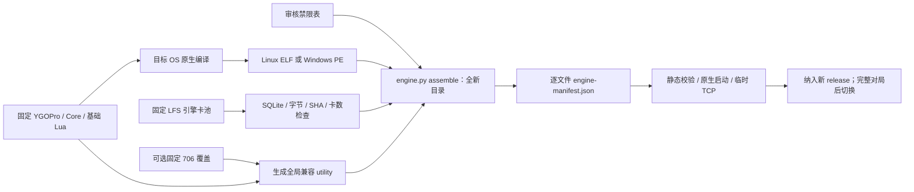

# YGOPro 引擎、环境卡池与旧裁定：安装和更新

2026-10-12 第二阶段补充。Linux 与 Windows 共用资源准备和校验，分别编译原生程序。
以下步骤只操作新构建/运行目录；正式服的替换、停机和迁移仍按具体部署授权执行。

本轮 assemble 要求基础 script 自身的 Git HEAD 等于固定 scriptCommit 且工作树干净，
manifest 记录 `baseLuaCommitVerified`；仅声明一个 commit 或拷贝近似脚本不能通过。
该字段只证明基础 Lua 来源，不证明二进制/Core 编译来源或与旧正式 EXE 的裁定等价，
后者必须绑定真实原生编译日志、逐文件 SHA 和规则对照验收。完整阻塞见 [当前矩阵](validation.md)。

## 资源和运行目录

| 输入 | 固定来源/责任 | 安装位置 |
| --- | --- | --- |
| 在线引擎与 Core | `versions.json → engine.source` 的主仓和子模块提交，协议 `0x1362` | Linux `ygopro`，Windows `ygopro.exe` |
| 基础 Lua | 同一源码的 `script` 子模块；始终必需 | `script/`，包含 constant/utility/procedure 及卡效果 |
| 环境引擎 CDB | `enginePoolSource`；当前正式服实际加载的 5,267 卡原件，独立 Git LFS | `cards.cdb` |
| 旧裁定覆盖 | `engine.oldRulings` 固定的 `301zrg/specials/706`；当前 706 部署选择启用，工具允许省略 | `specials/` |
| 全局旧裁定兼容 | 从所选基础 utility 与覆盖 special 生成，不改基础文件 | `specials/utility.lua` |
| 禁限表 | `engine.banlists` 中审核过的 SHA | `lflist.conf` |
| 服务端四语查询库 | 原 `catalogSource`，供查询/统计插件使用 | 应用的 `plugins/card-catalog/databases/`，不放进引擎 |



根 `cards.cdb` 是引擎读取的运行文件名。已确认正式服的 `cards1.cdb` 不参与当前加载，
新运行目录不把它作为必需文件、不合并两库、不新增按房切库。历史原件仍保存在原服及私有恢复批次。
网页裁剪产物与本机另一份同名大库不能代替这份已固定的小库。

本轮已发布卡池到资源仓库专用分支，完整提交为
[`7b29eb288411b64531e4a7c41642fb4beecf8709`](https://github.com/301zrg/srvprotianti-resources/commit/7b29eb288411b64531e4a7c41642fb4beecf8709)，
路径 `engine/1103-706/cards.cdb`，1,695,744 字节，SHA-256
`a49f0652ad54a7f55c569284ca154f0ec435fc26ebdd728927052e57b9d816e5`。
该分支的提交和 LFS 对象已上传，尚未合入资源仓库 main；完整 SHA 已可供工具下载。
四语查询库仍使用原独立提交，不随本次引擎卡池发布更换。

## 1. 准备源码、构建依赖和卡池

从服务端根目录执行；所有 destination 都必须不存在。Python 需要 3.12+，Git 和 Git LFS 需要可用。

```bash
python3 ops/scripts/engine-source.py --platform linux \
  --destination /private-staging/engine-build-20261012 --versions ops/versions.json
python3 ops/scripts/engine.py fetch-pool \
  --destination /private-staging/engine-pool-20261012 --versions ops/versions.json
python3 ops/scripts/engine.py check-pool \
  --pool /private-staging/engine-pool-20261012/cards.cdb --versions ops/versions.json
```

Windows 用 `python`/`py -3` 执行同一脚本，`--platform windows`，并改成自己的全新 Windows 路径。
`engine-source.py` 固定主仓、Core 和基础脚本提交，下载并检查 `versions.json` 中的依赖 SHA；
Linux 准备 Lua 与 Premake，Windows 另外准备 libevent、SQLite、liblzma 源码。
它只准备输入，不自动编译或声明与生产 EXE 完全一致。失败保留新目录供排查，下次用新目录重试。

Linux 还须安装 `build-essential libevent-dev libsqlite3-dev liblzma-dev`，记录实际包版本。
Lua 用下载的 C++ 构建源码，不随手改成系统 C Lua。Premake 固定 beta8；程序不能用 `server-latest` 替代。

旧裁定另取一份干净 checkout；示例 SHA 来自本次固定清单，更新时同时修改清单和命令：

```bash
git init /private-staging/old-rulings-20261012
git -C /private-staging/old-rulings-20261012 remote add origin https://github.com/301zrg/specials.git
git -C /private-staging/old-rulings-20261012 fetch --depth=1 origin d6008e9832e5666e665a84dca2e8e59810b3cdfa
git -C /private-staging/old-rulings-20261012 checkout --detach FETCH_HEAD
```

这个提交是可复现的候选覆盖来源，不是对生产全部脚本指纹一致的声明。
其他环境可以省略覆盖；需要其他审核来源时先更新对应 profile，不把当前 706 仓库变成通用必需项。

## 2. Linux 编译

在刚准备的 `engine-build-20261012/source` 目录执行：

```bash
cp -r premake/* .
cp -r resource/* .
./premake5 gmake --use-simd=sse2
make -C build -j2 config=release
file bin/release/ygopro
ldd bin/release/ygopro
sha256sum bin/release/ygopro
```

目标是 x86_64 ELF，动态依赖不能有 `not found`。SSE2 避免构建机自动选择 AVX2。
默认不启用 zip/pro2 额外模式，若需增加必须连同依赖、Core 和行为单独验收。
源码来源、编译输出和二进制 SHA 保存到构建报告；仅取得源码或看到端口不能证明编译/裁定通过。

## 3. Windows 编译

安装 Visual Studio 2022 Build Tools 的 C++ 工作负载/Windows SDK，使用含 MSBuild 的开发环境。
在 Windows source 目录的 PowerShell 执行：

```powershell
Copy-Item -Path 'premake\*' -Destination '.' -Recurse -Force
Copy-Item -Path 'resource\*' -Destination '.' -Recurse -Force
Copy-Item -LiteralPath 'premake\event\msvc-event-config.h' -Destination 'event\include\event2\event-config.h'
Copy-Item -LiteralPath 'event\WIN32-Code\nmake\evconfig-private.h' -Destination 'event\include\evconfig-private.h'
& '.\premake5.exe' vs2022 --use-simd=sse2
if ($LASTEXITCODE -ne 0) { throw 'Premake failed' }
& MSBuild.exe 'build\YGOPro.sln' /m /p:Configuration=Release /p:Platform=x64
if ($LASTEXITCODE -ne 0) { throw 'MSBuild failed' }
Get-FileHash -LiteralPath 'bin\release\x64\ygopro.exe' -Algorithm SHA256
```

源树、Core、Lua 和覆盖必须与 Linux 使用同一固定清单。PE32+ x64 与 ELF 是两种制品，
不能改名互用；不要从另一台机器复制 node_modules。Windows 构建所需 source 目录布局来自
[固定源码的服务端 workflow](https://github.com/mycard/ygopro/blob/5e63f18fb6b9a6ddc651bc2e8847eec9689ccbff/.github/workflows/server.yml)。

## 4. 组装全新运行目录

以下为 Linux 示例，源码目录与二进制来自第 2 步；禁限表由操作者提供审核原件。

```bash
python3 ops/scripts/engine.py assemble --platform linux \
  --base /private-staging/engine-build-20261012/source \
  --binary /private-staging/engine-build-20261012/source/bin/release/ygopro \
  --pool /private-staging/engine-pool-20261012/cards.cdb \
  --banlist /private-staging/reviewed-lflist.conf \
  --overlay /private-staging/old-rulings-20261012/706 \
  --destination /private-staging/engine-runtime-20261012 --versions ops/versions.json \
  --report /private-staging/engine-assembly-20261012.json
```

Windows 改为 `--platform windows`、真实 Windows 路径和 `bin/release/x64/ygopro.exe`。
省略 `--overlay` 就只使用基础 Lua。Windows 同目录 DLL 一并拷入新运行目录，并记录在 manifest。
工具只复制基础 Lua、选定程序、审核卡池与禁表，不复制 `.git`、配置、日志、录像或整个构建树。

禁表清单有两种明确范围：完整本机基准为 436,427 字节的多禁表原件，尚未在本轮重新封存生产原件；
`isolated-1103-only` 是网页固定源码的 `resources-staging/1103/lflist.conf`，可在纯 1103 隔离测试使用。
后者不能证明原服所有特殊房/其他禁表行为已迁移。正式复刻原服须另封存实际完整禁表，审核后更新 profile。

固定 server 源码的读取顺序为 `specials/<脚本>` → `expansions/script/<脚本>` → `script/<脚本>`。
组装目录不携带未知扩展，基础目录保持原字节；706 文件放入 `specials/`。
Core 开局读取 constant/utility/procedure，不自动执行独立 `special.lua`；组装器在 Auxiliary 定义后插入它并调用一次
`Auxiliary.PreloadUds()`，生成高优先级 `specials/utility.lua`。不适配的结构会被拒绝，不能只复制文件后填“已生效”。

## 5. 校验、接入宿主和验证效果

```bash
python3 ops/scripts/engine.py verify --platform linux \
  --engine /private-staging/engine-runtime-20261012 --versions ops/versions.json
python3 ops/scripts/engine.py smoke --platform linux \
  --engine /private-staging/engine-runtime-20261012 --versions ops/versions.json \
  --report /private-staging/engine-smoke-20261012.json
```

Windows 使用同样命令和 `--platform windows`。`smoke` 必须在目标原生 OS 执行，启动自有子进程、
使用系统分配的临时端口，检查本机 TCP 后停止该进程；不创建生产房间。
它只证明原生启动/监听，不证明对局、Lua 规则、TT 结算、恢复或正式网络。

把通过校验的运行目录作为新 release 的 `engine` 组件。Linux application/ygopro 链到该组件；
Windows 可在新 application 下放实体 `ygopro` 目录，或在明确的新 release 内配置 junction。
宿主从 application 工作目录启动，每房间以 `ygopro` 为 cwd，运行 `./ygopro`；Windows 由原生进程创建解析到 `ygopro.exe`。
预检传实体组件路径，避免让链接隐藏输入来源：`ops.py preflight --platform linux|windows ...`。

完整验收至少覆盖：协议/HostInfo、环境内卡可入房、超池卡与 TT 禁表拒绝、普通房及 G1–G3/换备、
两类有旧裁定差异的合成对局（如神警对反转召唤与武僧对反转怪）、观战、重连、计分、录像和四语使用率。
保留效果触发前后状态/原始协议证据；同一候选目录分别测启用/省略覆盖，不能用文件存在性代替裁定差异样本。
生产 EXE 的完整构建来源仍未证明与本 profile 完全一致，完整跨系统行为验收通过前只称“固定候选构建”。

## 更新和回退

1. 新增卡池 LFS 提交或固定脚本/Core/禁表版本，在新 profile/release 中记录来源、大小和 SHA。
2. 重新准备、编译、组装全新目录；执行 verify/smoke 和受影响的真实规则/客户端测试。
3. 维护入口设 stop，等房间与任务归零；停止宿主、引擎子进程和其他实际 writer，制作联合备份。
4. 切换整个已验证 engine/release，再启动仍处于维护状态的服务；按安装平台的验收通过后放行。
5. 回退整个匹配组件（程序、Core、基础/覆盖 Lua、CDB、禁表），保留上一批目录和 manifest。

不在线覆盖单张 CDB/Lua、不删除历史原件、不把校验通过改写成正式上线成功。
引擎资源更新与网页 Replay 固定 profile、桌面脚本更新是独立发布单元，分别按各自契约处理。
